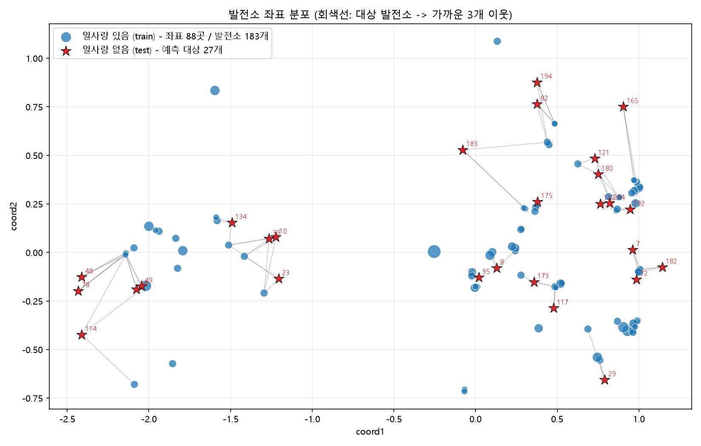

# OIBC 2025 일사량 예측 – 근처 발전소 앙상블

일부 태양광 발전소는 기상(일사량) 측정 장치가 없다. 이 과제는 **일사량(`nins`)이 비어 있는 발전소(test 27개)의 일사량을 예측**하는 문제다.
우리 팀은 최종 20위를 했고, 이 저장소는 당시 접근법을 **실제로 돌아가는 코드**로 정리한 것이다.

## 데이터에서 확인한 사실
| | train | test |
|---|---|---|
| 발전소 수 | 183 | 27 |
| 서로 다른 좌표 수 | **88** (같은 좌표에 여러 발전소) | 27 |
| 기간 | 2024-08-01 ~ 2025-08-01 (5분 간격) | **train 과 동일** |
| `nins` | 있음 | 없음 |

→ 시간축이 같고 위치만 다르므로, **"새로운 위치에서의 일사량 공간 보간"** 문제로 볼 수 있다.

## 좌표 시각화
파란 원: 일사량이 있는 발전소(train, 크기는 같은 좌표의 발전소 수) / 빨간 별: 예측 대상(test) / 회색선: 가까운 3개 이웃.



대상 발전소의 가장 가까운 이웃까지 거리(중앙값 ≈ 0.11)는 train 끼리의 최근접 거리(중앙값 ≈ 0.01)보다 훨씬 멀다.
그래서 검증은 **발전소가 아니라 좌표 단위로** hold-out 해야 한다 (같은 좌표의 발전소가 train/valid 에 갈리면 누수).

## 파이프라인
```
train.csv ─ 같은 좌표 발전소 평균 ─► 위치 x 시간 일사량 행렬 (88 x 105,120)
                │
                ├─► [ML]  LightGBM (좌표 + 시간 피처)  ──────────────┐
                │         src/ml_model.py                              ├─► w·ML + (1-w)·이웃  ─► 제출
                └─► [이웃] 가까운 k개 위치의 일사량 (단순/거리역수 평균) ─┘
                          src/common.py::neighbor_predict
좌표 단위 5-fold hold-out CV 로 k, 가중 방식, w 를 선택 (src/neighbor_ensemble.py)
```

1. **ML (`src/ml_model.py`)** – `notebooks/TSbaseline.ipynb` 를 정리. 기상 변수는 모두 제거하고 좌표 + 시간 피처(year, 연/일주기 sin·cos, 계절)만 사용하는 LightGBM. 모든 위치에서 `nins=0` 인 시각(밤)은 학습에서 빼고 0 으로 예측.
2. **이웃 앙상블 (`src/common.py`)** – 대상 위치에서 가까운 k개 위치의 일사량을 평균. `power=0` 이면 단순 평균(우리 팀 방식), `power>0` 이면 `1/d^power` 가중평균(1등 팀 방식).
3. **블렌딩 (`src/neighbor_ensemble.py`)** – `w·ML + (1-w)·이웃`. 좌표 단위 CV 로 (k, power, w)를 고르고 test 예측을 `outputs/submission.csv` 로 저장.

## 실행
```bash
pip install -r requirements.txt
# train.csv, test.csv 를 저장소 루트에 둔다 (용량 문제로 git 에는 올리지 않음)
python src/plot_map.py                 # 좌표 시각화 -> docs/coords_map.png
python src/neighbor_ensemble.py        # CV + 최종 예측 -> outputs/
# 빠르게 돌리기: python src/neighbor_ensemble.py --skip-cv --k 5 --power 1 --w 0.2
```
첫 실행 시 2.6GB csv 를 읽어 `cache/` 에 위치 단위 행렬을 저장하므로 이후에는 빠르다. CV 전체는 8코어 기준 약 9분.

## 좌표 단위 5-fold CV 결과
상세 결과는 [outputs/cv_results.csv](outputs/cv_results.csv). 지표는 전체 시각(밤 포함) 기준이며 대회 공식 지표와 다를 수 있다.

| 방법 | MAE | RMSE | MAE(주간) |
|---|---|---|---|
| ML 단독 (LightGBM) | 49.75 | 99.70 | 71.85 |
| 이웃 단순평균 (k=3) | 38.99 | 88.68 | 56.30 |
| **이웃 거리역수 가중평균 (k=5, 1/d)** | **36.38** | 84.43 | 52.54 |
| ML 0.2 + 이웃 IDW (k=5, 1/d) | 37.14 | **82.94** | 53.63 |

- 이 CV 에서는 **거리역수 가중평균이 MAE 최고**였고, ML 을 섞으면 MAE 는 약간 나빠지고 RMSE 는 좋아진다. (ML 단독은 가장 약함) 1등 팀이 ML 없이 거리 가중평균만 쓴 것과 같은 결론이다.
- 따라서 `outputs/best_config.json` 의 앙상블 설정은 MAE 기준 앙상블 중 최고인 `k=5, power=1, w_ml=0.2` 이다. MAE 만 본다면 `--w 0` 으로 이웃만 쓰는 편이 낫다.
- 주의: CV 의 hold-out 위치는 이웃이 상대적으로 촘촘해, 실제 test(이웃이 더 멂)보다 낙관적일 수 있다.

## 한계 / 참고
- `TSbaseline.ipynb` 가 쓰던 `nins_linera_interpolated_time.csv`(보간 구간 제거), `pv_cluster_map_by_input.csv`(환경 클러스터), `submission_sample.csv` 는 저장소에 없어 스크립트에서는 사용하지 않았다. 제출 파일은 `time, pv_id, nins` 열을 test.csv 순서로 저장한다.
- ML 하이퍼파라미터는 노트북의 optuna 튜닝 대신 고정값이다(`src/ml_model.py::PARAMS`). 학습 속도를 위해 시간축을 3스텝 간격으로 솎아 학습했다(`--stride`).

## 구성
```
src/common.py            데이터 로딩(좌표 단위 행렬), 이웃 예측, 지표
src/ml_model.py          LightGBM 시간+좌표 모델
src/neighbor_ensemble.py CV, 앙상블 가중치 선택, 제출 파일 생성
src/plot_map.py          좌표 시각화
notebooks/               당시 ML 베이스라인 노트북 (Baseline, TSbaseline)
```
