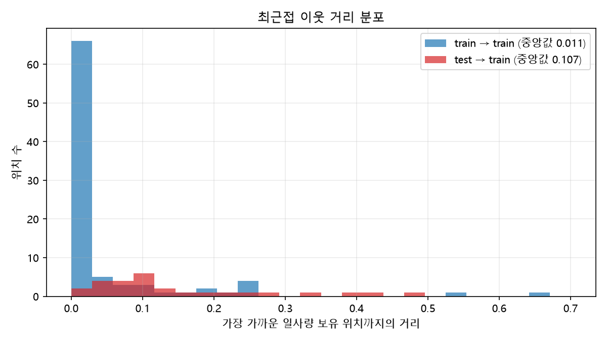
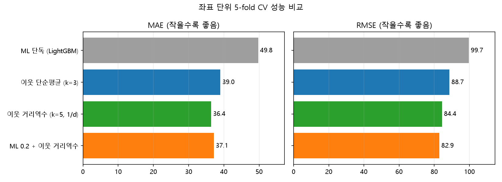

# Contest-OIBC2025-Solar-Irradiance-Prediction

**OIBC 2025 : 일사량 센서가 없는 태양광 발전소의 일사량 예측**

일부 태양광 발전소는 기상(일사량) 측정 장치가 없어서 근처 측정 장치의 값을 대신 쓰곤 합니다. 이 대회는 **일사량(`nins`)이 비어 있는 발전소 27곳의 일사량을 예측**하는 과제입니다.

| 항목 | 내용 |
|---|---|
| 최종 순위 | **20위** |
| 데이터 특성 | 5분 간격 1년치(105,120 스텝), 좌표는 익명화된 `coord1/coord2`, train/test 가 **같은 기간·다른 발전소** |
| 예측 대상 | test 발전소 27개 (train 183개 발전소는 `nins` 제공) |
| 접근 | 좌표 시각화 → LightGBM(좌표+시간) + **근처 발전소 일사량 앙상블** |
| 검증 | 좌표 단위 5-fold hold-out CV (MAE / RMSE) |

## 데이터에서 확인한 것

|  | train | test |
|---|---|---|
| 발전소 수 | 183 | 27 |
| 서로 다른 좌표 수 | **88** (같은 좌표에 여러 발전소) | 27 |
| 기간 | 2024-08-01 ~ 2025-08-01 | **train 과 동일** |
| `nins` | 있음 | 없음 |

시간축이 같고 위치만 다르므로 **"새로운 위치에서의 일사량 공간 보간"** 문제로 볼 수 있습니다. 그래서 먼저 발전소 좌표를 색으로 구분해 그려보았습니다.


파란 원은 일사량이 있는 발전소(train, 크기는 같은 좌표의 발전소 수), 빨간 별은 예측 대상(test), 회색선은 대상 발전소와 가까운 이웃 3곳입니다.
대상 발전소는 대부분 일사량을 아는 발전소들 근처에 있습니다. 즉 **근처 발전소의 일사량이 곧 강한 단서**가 됩니다. 다만 이웃까지의 거리는 train 끼리보다 훨씬 멉니다(중앙값 0.107 vs 0.011).



→ 같은 좌표의 발전소가 train/valid 에 갈라지면 누수가 생기므로, 검증은 **발전소가 아니라 좌표 단위**로 나눴습니다.

## 솔루션 한눈에 보기

```
 train.csv ── 같은 좌표 발전소 평균 ──► 위치 x 시간 일사량 행렬 (88 x 105,120)
                     │
                     ├──► [ML]   LightGBM (좌표 + 시간 피처) ─────────────┐
                     │                                                     ├─► w·ML + (1-w)·이웃 ─► 제출
                     └──► [이웃] 가까운 k개 위치의 일사량 (평균 / 거리역수) ─┘
 좌표 단위 5-fold CV 로 k, 가중 방식, 블렌딩 비율 w 선택
```

## 사용한 기법 (적용 순서)

### 1. 전처리

| # | Method | 기능 | 효과 | 코드 |
|---|---|---|---|---|
| 1 | **좌표 단위 평균** | 같은 좌표의 발전소 `nins` 를 평균해 (위치 x 시간) 행렬로 변환 | 183개 발전소 → 88개 위치. 중복 위치로 인한 CV 누수 방지 | [src/data.py](src/data.py) `load_data` |
| 2 | **결측 시각 보간** | 드물게 비는 시각을 시간 방향 선형 보간 | 행렬을 완전한 형태로 유지 | 〃 |
| 3 | **밤 구간 분리** | 모든 위치에서 `nins=0` 인 시각(전체의 약 31%)은 학습에서 제외하고 0 으로 예측 | 학습 데이터 절감, 밤 오차 0 | [src/ml_model.py](src/ml_model.py) `day_mask` |

### 2. ML 파트 (좌표 + 시간)

기존 `notebooks_original/TSbaseline.ipynb` 의 파이프라인을 스크립트로 정리했습니다. 기상 변수는 모두 제거하고 좌표와 시간 피처만 씁니다.

| # | Method | 기능 | 효과 | 코드 |
|---|---|---|---|---|
| 1 | **시간 피처** | year, 연 주기(day of year) sin/cos, 하루 주기 sin/cos, 계절 | 시각·날짜마다의 일사 패턴을 모델이 구분 | [src/ml_model.py](src/ml_model.py) `time_features` |
| 2 | **LightGBM (좌표 + 시간)** | `coord1, coord2` 와 시간 피처로 `nins` 회귀 | 새 좌표에 대한 일사량 보간 | [src/ml_model.py](src/ml_model.py) `fit_predict` |

### 3. 근처 발전소 앙상블 (이 저장소에서 추가)

| # | Method | 기능 | 효과 | 코드 |
|---|---|---|---|---|
| 1 | **이웃 단순평균** | 가까운 k개 위치의 일사량 평균 (당시 우리 팀 방식) | 같은 시각의 실측값을 직접 활용 | [src/neighbors.py](src/neighbors.py) `neighbor_predict(power=0)` |
| 2 | **이웃 거리역수 가중평균** | 가중치 `1/d^power` (1등 팀 방식) | 가까운 발전소에 더 큰 비중 | [src/neighbors.py](src/neighbors.py) `neighbor_predict(power>0)` |
| 3 | **ML + 이웃 블렌딩** | `w·ML + (1-w)·이웃` | 두 예측의 오차 상쇄 (특히 RMSE) | [src/pipeline.py](src/pipeline.py) |
| 4 | **좌표 단위 K-Fold CV** | 위치를 fold 로 나눠 hold-out, `(k, power, w)` 선택 | 새 위치 일반화 성능 측정 | [src/pipeline.py](src/pipeline.py) `cross_validate` |

## 결과 (좌표 단위 5-fold CV)



| 방법 | MAE | RMSE | MAE(주간) |
|---|---|---|---|
| ML 단독 (LightGBM) | 49.75 | 99.70 | 71.85 |
| 이웃 단순평균 (k=3) | 38.99 | 88.68 | 56.30 |
| **이웃 거리역수 가중평균 (k=5, 1/d)** | **36.38** | 84.43 | 52.54 |
| ML 0.2 + 이웃 거리역수 (k=5) | 37.14 | **82.94** | 53.63 |

전체 결과는 [outputs/cv_results.csv](outputs/cv_results.csv) 에 있습니다. 지표는 밤을 포함한 전체 시각 기준이며 대회 공식 지표와 다를 수 있습니다.

- **ML 단독은 가장 약했고**, 가까운 발전소의 실측 일사량을 쓰는 편이 훨씬 좋았습니다.
- **거리역수 가중평균이 MAE 최고**였습니다. ML 을 섞으면 MAE 는 약간 나빠지지만 RMSE 는 좋아집니다. 1등 팀이 ML 없이 거리 가중평균만 쓴 결과와 일치합니다.
- `outputs/best_config.json` 은 블렌딩 중 최고인 `k=5, power=1, w_ml=0.2` 입니다. MAE 만 본다면 `--w 0` 으로 이웃만 쓰는 편이 낫습니다.
- CV 의 hold-out 위치는 이웃이 상대적으로 촘촘해서, 이웃이 더 먼 실제 test 에서는 점수가 더 나쁠 수 있습니다.

## 폴더 구조

```
├── docs/                      좌표 지도, 이웃 거리 분포, CV 비교 그래프
├── src/
│   ├── data.py                CSV -> (위치 x 시간) 일사량 행렬 로딩 + 캐시
│   ├── ml_model.py            시간 피처 + LightGBM
│   ├── neighbors.py           이웃 평균 / 거리역수 가중평균
│   ├── metrics.py             MAE / RMSE
│   └── pipeline.py            좌표 단위 CV, 블렌딩, 제출 파일 생성
├── scripts/train_predict.py   CV -> 최종 예측 -> outputs/submission.csv
├── eda/
│   ├── plot_map.py            좌표 시각화 (train vs test)
│   └── nn_distance.py         최근접 이웃 거리 분포
├── experiments/plot_cv.py     CV 결과 그래프
├── outputs/                   cv_results.csv, best_config.json
└── notebooks_original/        당시 ML 베이스라인 노트북 (Baseline, TSbaseline)
```

## 실행 방법

```bash
pip install -r requirements.txt

# 대회 데이터(train.csv, test.csv)를 저장소 루트에 배치
python eda/plot_map.py                  # 좌표 시각화 -> docs/coords_map.png
python eda/nn_distance.py               # 이웃 거리 분포 -> docs/nn_distance.png
python scripts/train_predict.py         # CV + 최종 예측 -> outputs/ (8코어 기준 약 9분)
python experiments/plot_cv.py           # CV 그래프 -> docs/cv_comparison.png

# 빠른 실행 (CV 생략, 설정 직접 지정)
python scripts/train_predict.py --skip-cv --k 5 --power 1 --w 0.2
```

첫 실행 때 2.6GB csv 를 읽어 `cache/` 에 위치 단위 행렬을 저장하므로 이후에는 빠릅니다.

## 참고 사항

- 대회 데이터는 저장소에 포함하지 않았습니다(`.gitignore`).

